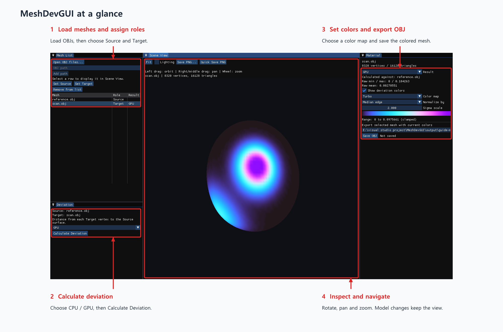
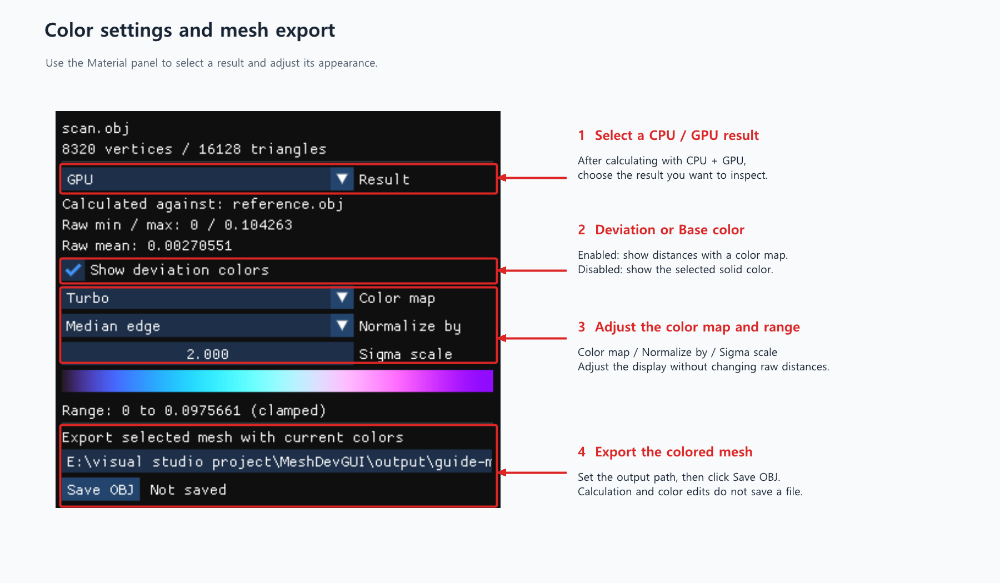
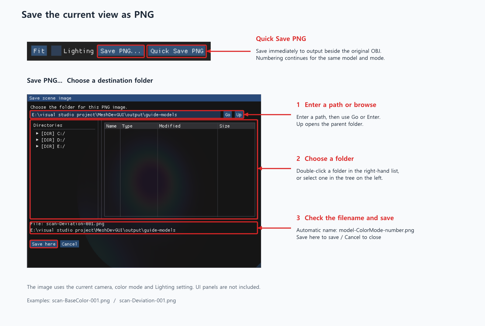

# MeshDevGUI

[한국어](README.md) | **English**

MeshDevGUI is a Windows GUI application for measuring surface deviation between two OBJ models and visualizing the differences with a color map. Calculate distances on the CPU or GPU, inspect the results, and export a colored mesh or an image of the current view.

[Download for Windows](https://github.com/aister9/MeshDevGUI/releases/latest) · [Load and compare models](#load-models-and-calculate-deviation) · [Color settings](#color-settings-and-mesh-export) · [Save images](#save-the-current-view-as-an-image)

## Getting started

1. Download the Windows ZIP from [Releases](https://github.com/aister9/MeshDevGUI/releases/latest).
2. Extract the entire archive and run **MeshDevGUI.exe**. Keep the included DLLs beside the EXE.
3. Prepare the OBJ models you want to compare. Both models must use the same coordinate system and units.

You do not need to install the CUDA Toolkit or Visual Studio. A compatible **NVIDIA GPU and driver** are required; see the release notes for the supported environment.

## Workspace overview



*These images use the application's actual UI and demonstration models. Click an image to enlarge it.*

| Panel | What it does |
|---|---|
| **Mesh List** | Load OBJ files, select the displayed model, and assign Source and Target |
| **Deviation** | Choose CPU/GPU processing and calculate distances |
| **Scene View** | Inspect the model, control the camera, and save PNG images |
| **Material** | Select a calculation result, adjust colors, and export OBJ files |

## Load models and calculate deviation

1. Use **Mesh List → Open OBJ files...** to load your models. You can select multiple files, or enter a path and click **Add path**.
2. Select the reference model and click **Set Source**. Select the model to compare and click **Set Target**.
3. In **Deviation**, choose `CPU`, `GPU`, or `CPU + GPU`, then click **Calculate Deviation**.
4. When calculation finishes, the Target is selected and displayed. Click another model in the list to change the displayed model.

Each result is the **distance from a Target vertex to the Source surface**. Calculation stores the raw distances without automatically saving any files. With `CPU + GPU`, you can inspect the two results separately.

### Camera controls

| Control | Action |
|---|---|
| Left-button drag | Rotate |
| Right- or middle-button drag | Pan |
| Mouse wheel | Zoom |
| **Fit** | Frame the selected model |
| **Lighting** | Turn lighting on or off |

The first model is framed automatically. Switching models preserves the camera view; click **Fit** to frame the newly selected model.

## Color settings and mesh export



- **Result**: Choose which result to inspect after calculating with `CPU + GPU`.
- **Show deviation colors enabled**: Display distances with a color map. Use **Color map**, **Normalize by**, and **Sigma scale** to adjust the palette and color range.
- **Show deviation colors disabled**: Display the solid color selected in **Base color**.
- **Save OBJ**: Check the output path, then click to export the selected mesh with its current colors.

Color settings are kept separately for each model. Changing the color map or range does not change the raw distances or require recalculation.

## Save the current view as an image



| Save option | How to use it |
|---|---|
| **Save PNG...** | Choose a folder in the dialog, then click **Save here**. If you type a path, click **Go** or press Enter to navigate to it. |
| **Quick Save PNG** | Immediately save into an `output` folder created beside the original OBJ file. |

The PNG uses the current **camera view, color mode, and Lighting setting**. UI panels are not included. To save both deviation and base color images from the same viewpoint, toggle **Show deviation colors** and save each version.

Filenames are generated automatically:

```text
model-BaseColor-001.png
model-Deviation-001.png
model-Deviation-002.png
```

For each **model name and color mode**, numbering continues after the highest existing number in the destination folder. The regular save dialog remembers the last chosen folder during the session. Quick Save always uses the original model's `output` folder.

Loaded models and calculation results are not retained in the workspace after you close the app. Use **Save OBJ** or PNG export to keep the results you need before exiting.
