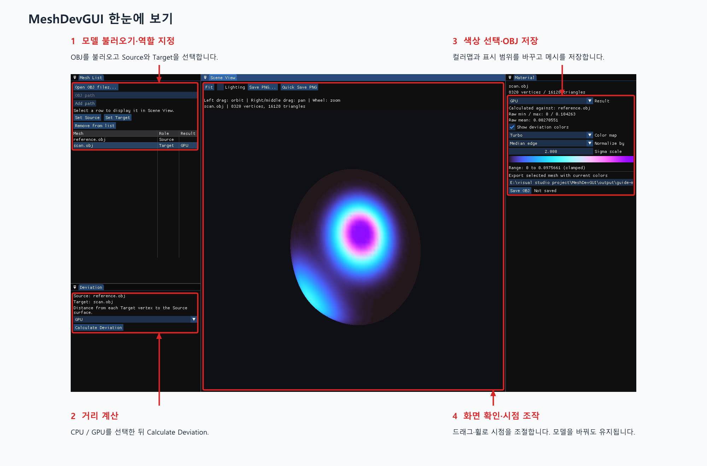
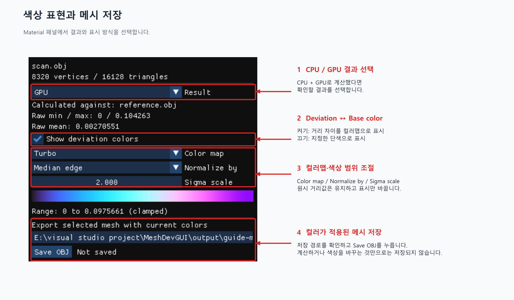
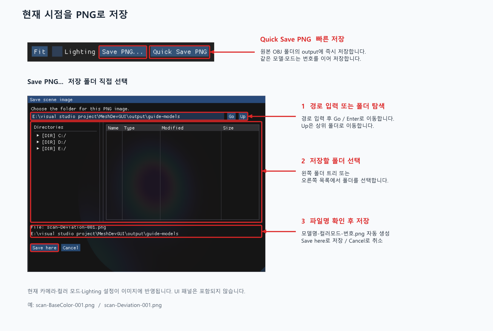

# MeshDevGUI

**한국어** | [English](README.en.md)

MeshDevGUI는 두 OBJ 모델 사이의 표면 거리(deviation)를 계산하고, 차이를 컬러맵으로 확인하는 Windows GUI 앱입니다. CPU 또는 GPU로 계산한 결과를 살펴보고, 컬러가 적용된 메시와 현재 시점의 이미지를 저장할 수 있습니다.

[Windows 앱 다운로드](https://github.com/aister9/MeshDevGUI/releases/latest) · [모델 불러오기·계산](#모델-불러오기와-deviation-계산) · [색상 설정](#색상-설정과-메시-저장) · [이미지 저장](#현재-시점을-이미지로-저장)

## 시작하기

1. [Releases](https://github.com/aister9/MeshDevGUI/releases/latest)에서 Windows ZIP을 다운로드합니다.
2. 압축을 모두 풀고 **MeshDevGUI.exe**를 실행합니다. 함께 들어 있는 DLL은 EXE 옆에 둡니다.
3. 비교할 OBJ 파일을 준비합니다. 두 모델은 같은 좌표계와 단위를 사용해야 합니다.

CUDA Toolkit이나 Visual Studio를 따로 설치할 필요는 없습니다. 호환되는 **NVIDIA GPU와 드라이버**가 필요하며, 지원 환경은 Release 안내에서 확인할 수 있습니다.

## 화면 구성



*이미지는 앱의 실제 UI와 설명용 모델을 사용했습니다. 클릭하면 크게 볼 수 있습니다.*

| 패널 | 할 수 있는 일 |
|---|---|
| **Mesh List** | OBJ 불러오기, 표시할 모델 선택, Source·Target 지정 |
| **Deviation** | CPU/GPU 선택과 거리 계산 |
| **Scene View** | 모델 확인, 카메라 조작, PNG 저장 |
| **Material** | 계산 결과 선택, 컬러맵·단색 설정, OBJ 저장 |

## 모델 불러오기와 deviation 계산

1. **Mesh List → Open OBJ files...**로 모델을 불러옵니다. 여러 파일을 선택하거나, 경로 입력 후 **Add path**를 눌러도 됩니다.
2. 기준 모델을 선택하고 **Set Source**, 비교할 모델을 선택하고 **Set Target**을 누릅니다.
3. **Deviation**에서 `CPU`, `GPU`, `CPU + GPU` 중 하나를 선택하고 **Calculate Deviation**을 누릅니다.
4. 계산이 끝나면 Target이 선택되어 화면에 표시됩니다. 목록에서 다른 모델을 클릭하면 표시 모델이 바뀝니다.

계산값은 **Target의 각 정점에서 Source 표면까지의 거리**입니다. 계산 단계에서는 거리값만 보관하며, 파일은 자동으로 저장하지 않습니다. `CPU + GPU`로 계산하면 두 결과를 각각 확인할 수 있습니다.

### 카메라 조작

| 조작 | 기능 |
|---|---|
| 왼쪽 버튼 드래그 | 회전 |
| 오른쪽 또는 가운데 버튼 드래그 | 이동 |
| 마우스 휠 | 확대·축소 |
| **Fit** | 선택한 모델을 화면에 맞춤 |
| **Lighting** | 조명 효과 켜기·끄기 |

첫 모델은 자동으로 화면에 맞춥니다. 이후 모델을 바꿔도 카메라 시점은 유지되며, 다시 맞추려면 **Fit**을 누릅니다.

## 색상 설정과 메시 저장



- **Result**: `CPU + GPU`로 계산한 경우 확인할 결과를 선택합니다.
- **Show deviation colors 켜기**: 거리 차이를 컬러맵으로 표시합니다. **Color map**, **Normalize by**, **Sigma scale**로 팔레트와 색상 범위를 조절합니다.
- **Show deviation colors 끄기**: **Base color**에서 선택한 단색으로 표시합니다.
- **Save OBJ**: 출력 경로를 확인한 뒤 누르면, 선택한 모델에 현재 색상이 적용된 OBJ를 저장합니다.

색상 설정은 모델별로 유지됩니다. 컬러맵이나 범위를 바꿔도 원시 거리값은 바뀌지 않으며, 다시 계산할 필요도 없습니다.

## 현재 시점을 이미지로 저장



| 저장 방식 | 사용 방법 |
|---|---|
| **Save PNG...** | 다이얼로그에서 폴더를 선택하고 **Save here**를 누릅니다. 경로를 직접 입력했다면 **Go** 또는 Enter로 이동합니다. |
| **Quick Save PNG** | 원본 OBJ가 있는 폴더에 `output` 폴더를 만들고 즉시 저장합니다. |

현재 **카메라 시점·컬러 모드·Lighting 설정**이 PNG에 반영됩니다. UI 패널은 포함되지 않습니다. 같은 시점에서 deviation 이미지와 base color 이미지를 각각 저장하려면 **Show deviation colors**를 전환한 뒤 저장하세요.

파일명은 자동으로 정해집니다.

```text
모델명-BaseColor-001.png
모델명-Deviation-001.png
모델명-Deviation-002.png
```

같은 저장 폴더에서 **모델명과 컬러 모드별로 기존 최대 번호 다음 번호**를 사용합니다. 일반 저장에서 선택한 폴더는 앱을 실행하는 동안 기억하며, 빠른 저장은 항상 원본 모델 폴더의 `output`을 사용합니다.

앱을 종료하면 불러온 모델과 계산 결과는 작업 공간에서 사라집니다. 필요한 결과는 종료 전에 **Save OBJ** 또는 PNG 저장으로 남겨 주세요.
